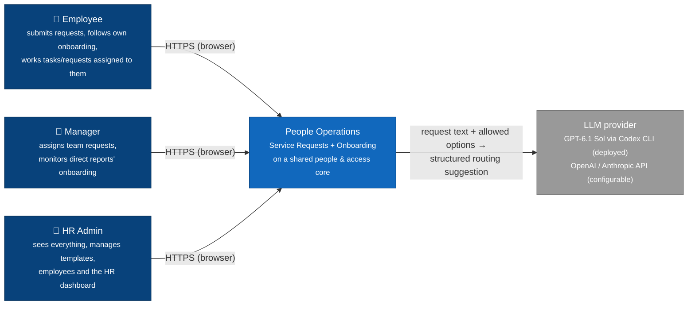
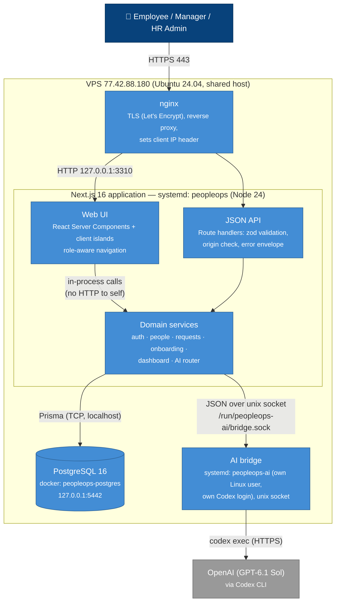
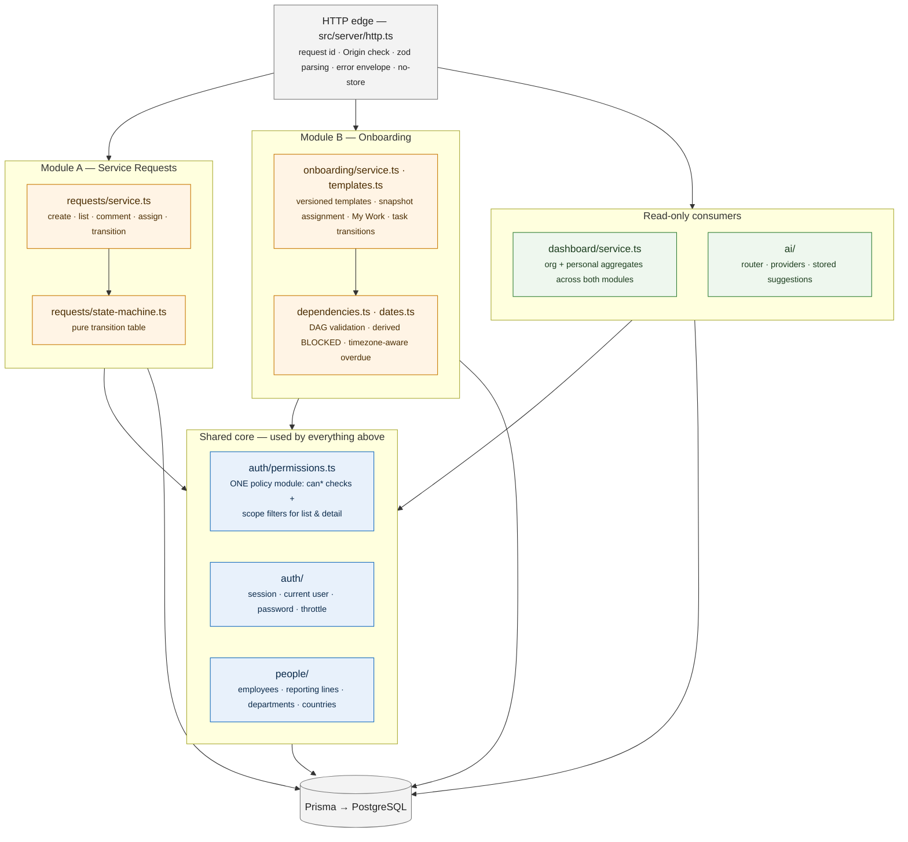
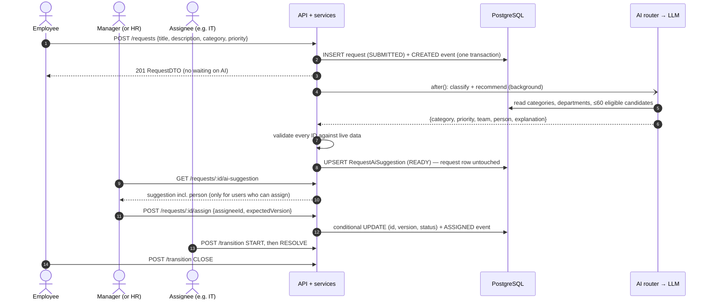
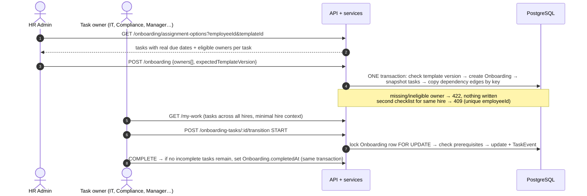
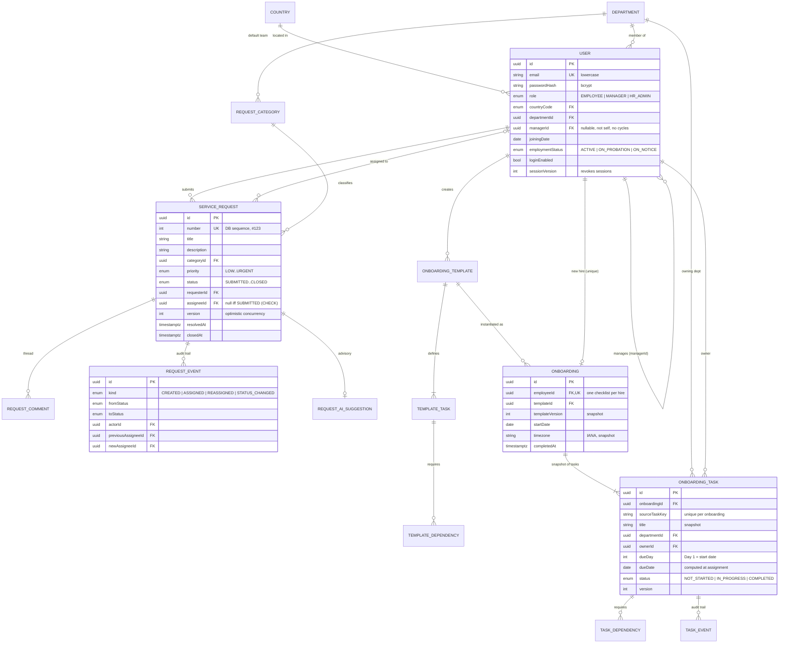
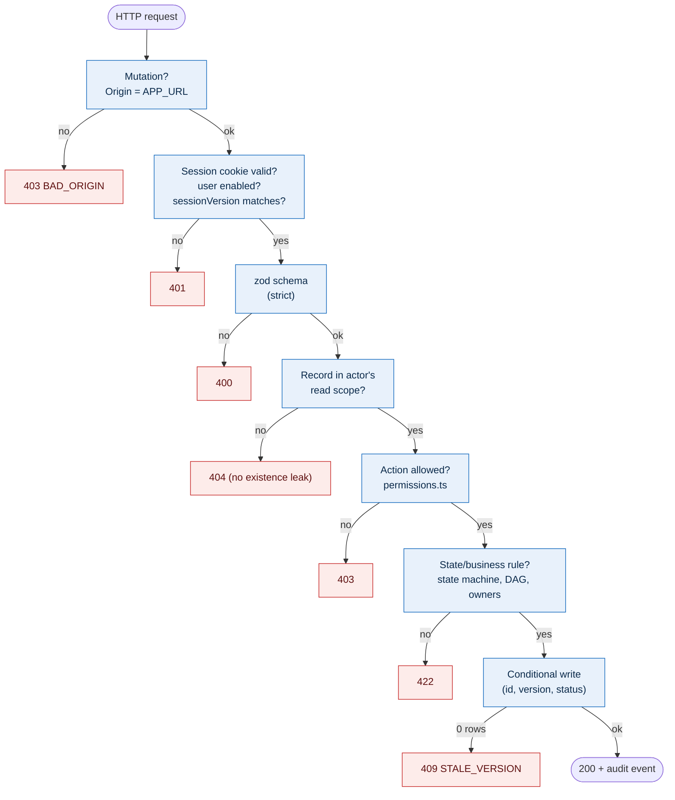
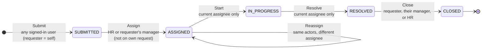
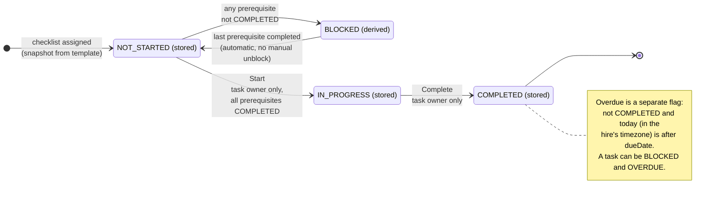

# People Operations — System Design

| | |
| --- | --- |
| **System** | People Operations: service requests + employee onboarding for Next Ventures (≈100 staff, 4 countries) |
| **Author** | Imran (with Claude as implementation partner) |
| **Status** | **Implemented and deployed** — https://peopleops.77-42-88-180.sslip.io |
| **Revision history** | v1 design written and committed before any application code (`75e0644`, 2026-11-09). This is the as-built revision; every change from v1 is in the [decision log](#11-decision-log). |
| **Companion docs** | [API contract](docs/API_CONTRACT.md) · [Permissions](docs/PERMISSIONS.md) · [Acceptance evidence](docs/ACCEPTANCE.md) · [Deployment runbook](deploy/DEPLOY.md) · [Debug log](DEBUG_LOG.md) |

## TL;DR

One Next.js application with one PostgreSQL database. Both workflows sit on **one shared core**: people, roles, reporting lines, departments, authentication and a single permission module.

- **Service Requests** are a strict, audited state machine.
- **Onboarding** turns reusable templates into per-hire checklists. Tasks have owners, real calendar deadlines and prerequisites.
- **An HR dashboard** reads both modules, including the cross-module question "which new hires are still waiting on IT equipment?".
- **The AI feature is an Intelligent Request Router.** It classifies each new request and recommends a team and a person to assign. It is advisory only: it can never assign, approve or change a request. Every recommendation is checked against live database IDs.

**How to read this document.** Sections are numbered to match the assessment brief:

| Brief section | Where to look |
| --- | --- |
| 1.1 High-level architecture | [§1](#1-high-level-architecture) — system context, containers, components, deployment, key flows |
| 1.2 Data model | [§2](#2-data-model) — ERD, data dictionary, how the modules share data, why PostgreSQL |
| 1.3 API design | [§3](#3-api-design) — every endpoint, grouped by domain |
| 1.4 Access control | [§4](#4-access-control) — role matrix and how it is enforced |
| 1.5 State machines | [§5](#5-state-machines) — request and onboarding-task lifecycles |
| 1.6 Trade-offs | [§6](#6-trade-offs-architecture-decisions) — nine decisions (ADR format) |

---

## 0. Context and scope

**Problem.** Today requests travel over email and Slack, and onboarding lives in spreadsheets. Requests get lost, and onboarding tasks spread across IT, HR, managers and Compliance get missed or done late.

**Goals**
- Give every request a tracked lifecycle with clear ownership (who can assign, start, resolve and close).
- Make onboarding repeatable: HR defines a template once; each hire gets dated tasks with owners and prerequisites; owners see their work across all hires.
- One login, three roles (Employee, Manager, HR Admin), with data scoped by the server, not just hidden in the UI.
- One HR view across both modules.
- An AI feature that removes routine triage work, without weakening access control.

**Non-goals (deliberately out of scope)**
- Payroll, leave management, performance reviews, attachments, email or notification delivery, password reset, self-service signup, multi-tenant support.
- Reopening closed requests or completed tasks (see [limitations](#9-risks-and-limitations)).
- Autonomous AI actions. The AI recommends; a person decides.

**Assumptions** (project decisions where the brief is silent; listed so they can be challenged):
1. A manager's **team = direct reports** (`User.managerId`), not everyone in the same department or country.
2. **Assigning a request is the manager's approval.** There is no separate "approved" state.
3. Every role can submit its own requests and see its own onboarding. A role only adds privileges; **department is not a role**.
4. Someone assigned a request can read and work **that request**, even if it came from another team (the assignee exception).
5. One onboarding checklist per employee. Deadlines are calendar days: Day 1 is the joining date, "Week 1" is Day 7, "Day 30" is the joining date + 29.
6. "Overdue" is a computed flag, not a status, so a task can be Blocked *and* Overdue.
7. Template edits apply to future assignments only; assigned checklists are snapshots.

---

## 1. High-level architecture

The diagrams follow the [C4 model](https://c4model.com): **context** (who uses the system and what it talks to), **containers** (deployable or runnable pieces), **components** (modules inside the application), then deployment and the key runtime flows.

### 1.1 System context (C4 level 1)



There are no other integrations: no email, Slack or HR system of record. That is an explicit non-goal for this version.

### 1.2 Containers (C4 level 2)



| Container | Technology | Responsibility | Why it is separate |
| --- | --- | --- | --- |
| Web UI + JSON API + domain services | Next.js 16 (App Router), TypeScript, Prisma 6 | All business logic, authorization and rendering | One deployable keeps a 4-day build simple. Module boundaries live in code (§1.3), not in separate network services |
| PostgreSQL | PostgreSQL 16 in its own container | System of record | Relational integrity, constraints and transactions (§2.4) |
| AI bridge | Node + Codex CLI under a separate Linux user | Runs one locked-down model call per suggestion | Keeps ChatGPT credentials away from the app user and the app's secrets away from the model process |
| nginx | Existing host proxy | TLS and routing | Already shared by other sites on the VPS; this app gets its own server block |

### 1.3 Components inside the application (C4 level 3)

The two modules never call into each other. Both depend on the **shared core**. The dashboard and AI router are read-only consumers.



Rules that keep the structure honest:
- **Authorization lives in one place.** Services call `permissions.ts`. Pages and buttons only *reflect* `allowedActions` computed on the server; hiding a button is never the security control.
- **Database access exists only in `src/server/**`.** Server-rendered pages call the same services as the API.
- **Full user records are never serialized.** DTO mappers return `UserSummary` / `EmployeeDTO`; password hashes and session data never leave the server or reach logs.
- **Request text and comments are plain text,** rendered escaped by React.

### 1.4 Deployment view

| Concern | Choice |
| --- | --- |
| Host | Shared Ubuntu VPS. App isolated as system user `peopleops`, listening on `127.0.0.1:3310` only |
| Edge | nginx server block for `peopleops.77-42-88-180.sslip.io`, Let's Encrypt certificate, HTTP→HTTPS redirect. `X-Forwarded-For` is *overwritten* so clients can't spoof it |
| Database | Dedicated `postgres:16-alpine` container bound to localhost, named volume, 256 MB memory limit |
| Secrets | `/etc/peopleops/peopleops.env` (root:peopleops 0640). Nothing secret is committed; `.env.example` holds placeholders |
| Releases | Next.js standalone build made off-box (the VPS is memory-constrained), shipped as `releases/<git sha>`, switched with a symlink. Rollback = repoint the symlink |
| Migrations / seed | `prisma migrate deploy` only (never reset). Seeding needs an explicit `ALLOW_ASSESSMENT_SEED=true` and never runs on boot |

Full runbook: [deploy/DEPLOY.md](deploy/DEPLOY.md).

### 1.5 Key runtime flows

**A request from submission to closure, including the AI recommendation**



**Assigning an onboarding checklist and working it**



---

## 2. Data model

### 2.1 Entity-relationship diagram



The diagram shows the key attributes. The complete field list is in the data dictionary below.

### 2.2 Data dictionary

`uuid` = server-generated; `text(n)` = maximum length enforced by the database and validation; `timestamptz` = UTC instant; `date` = calendar date; `?` = nullable.

| Table | Fields and constraints |
| --- | --- |
| **Shared core** | |
| Country | code `BD/MY/LK/CY` PK; name unique; timezone (IANA) |
| Department | id PK; name text(80) unique; isActive. Includes a "Manager" pseudo-department used for manager-owned onboarding tasks |
| User | id PK; name text(120); email text(254) unique, CHECK lowercase; passwordHash; role; countryCode FK; departmentId FK; managerId? self-FK, CHECK ≠ id; joiningDate date; employmentStatus; loginEnabled; sessionVersion; createdAt/updatedAt |
| LoginThrottle | keyHash PK (SHA-256 of email + client IP, or email + `*`); windowStartedAt; attemptCount; expiresAt |
| AiUsageBucket | (userId, windowStart) PK; count — per-user, per-minute AI budget |
| **Module A** | |
| RequestCategory | id PK; code unique (IT_EQUIPMENT, SOFTWARE_ACCESS, HR_QUERY, FACILITIES, OTHER); name; defaultDepartmentId FK |
| ServiceRequest | id PK; number unique (sequence); title text(160); description text(5000); categoryId FK; priority; status; requesterId FK; assigneeId? FK; version; createdAt/updatedAt; resolvedAt?; closedAt?. CHECK `status = SUBMITTED ⇔ assigneeId IS NULL` |
| RequestComment | id PK; requestId FK; authorId FK; body text(3000); createdAt |
| RequestEvent | id PK; requestId FK; actorId FK; kind; fromStatus?; toStatus; previousAssigneeId?/newAssigneeId? FK; createdAt. Append-only |
| RequestAiSuggestion | requestId PK/FK; status `PENDING/READY/FAILED`; categoryId?, priority?, suggestedDepartmentId?, suggestedAssigneeId? (all FKs); explanation text(300)?; failureReason?; timestamps. CHECK READY ⇒ category, priority and department are set |
| **Module B** | |
| OnboardingTemplate | id PK; name text(120); description text(2000); isActive; version; createdById FK; timestamps |
| TemplateTask | id PK; templateId FK; key text(50); title; description; departmentId FK; dueDay ≥ 1 (CHECK); sortOrder ≥ 0 (CHECK); unique (templateId, key) and (templateId, sortOrder) |
| TemplateDependency | (taskId, prerequisiteTaskId) PK; CHECK no self-edge; same-template rule and acyclicity checked in the service |
| Onboarding | id PK; employeeId FK **unique**; templateId FK; templateVersion; templateName; startDate; timezone; assignedById FK; assignedAt; completedAt? |
| OnboardingTask | id PK; onboardingId FK; sourceTaskKey; title/description (snapshot); departmentId FK; ownerId FK; dueDay; dueDate; status; sortOrder; version; startedAt?; completedAt? (CHECK completedAt set ⇔ COMPLETED); unique (onboardingId, sourceTaskKey) |
| TaskDependency | (taskId, prerequisiteTaskId) PK; CHECK no self-edge |
| TaskEvent | id PK; taskId FK; actorId FK; fromStatus; toStatus; createdAt. Append-only |

**Indexes**, chosen for the actual queries:
- User: (managerId), (countryCode, employmentStatus), (departmentId)
- ServiceRequest: (requesterId, createdAt), (assigneeId, status), (status, categoryId), (priority)
- Comments and events: (requestId, createdAt)
- Dependencies: reverse prerequisite indexes
- OnboardingTask: (ownerId, status), (onboardingId, status), (dueDate, status)
- LoginThrottle: (expiresAt)

**Referential rules.** Every reference to people, departments or categories uses `ON DELETE RESTRICT`. There are no hard deletes: an employee leaving is `loginEnabled = false`, and history keeps pointing at real rows.

### 2.3 How the two modules share data without duplication

| Shared concept | Single source | Used by Module A as | Used by Module B as |
| --- | --- | --- | --- |
| Person | `User` | requester, assignee, comment author, event actor | new hire, task owner, template author, event actor |
| Team | `Department` | a category's default team; the AI's "suggested team" | a task's owning department; who is eligible to own it |
| Reporting line | `User.managerId` | the manager may assign and close the team's requests | the manager sees reports' checklists and owns "Manager" tasks |
| Location and time | `Country` (+ IANA timezone) | dashboard filters, AI prefers same-country assignees | deadlines and "overdue" are computed in the hire's timezone |
| Access rules | `permissions.ts` | `canReadRequest`, `canAssignRequest`, … | `canReadOnboarding`, `canWorkTask`, … |
| Audit pattern | `*Event` tables (actor, from, to, time) | `RequestEvent` | `TaskEvent` |

There are no per-module copies of people or teams. Only one thing is copied on purpose: **an assigned checklist copies its template's tasks** (title, description, department, due day, dependencies). Editing a template must not silently change a new hire's existing deadlines or delete tasks someone is already working on ([ADR-4](#adr-4--snapshot-checklists-vs-live-templates)). The copy keeps `templateId`, `templateVersion` and `sourceTaskKey`, so you can always trace where it came from.

Both modules come together in the dashboard query "new hires (joined ≤ 60 days ago, have a checklist) with open IT-equipment requests". That is one join through `User`, with no synchronisation job.

### 2.4 Why PostgreSQL (and this shape)

- **The data is relational and its rules can be enforced in the database.** Reporting hierarchies, dependency graphs, requests that refer to people and categories, and audit trails all benefit from foreign keys, unique constraints and `CHECK` constraints. For example, "an unassigned request must be SUBMITTED" is enforced by the database itself, not only by application code.
- **Workflows need transactions.** A state change and its audit event must commit together. Creating a checklist (onboarding + 10–12 tasks + dependency edges) must be all-or-nothing. Two people finishing the last two tasks at once must still mark the checklist complete (a row lock — `SELECT … FOR UPDATE`).
- **Reporting is SQL-shaped.** Grouping by country, status and category, plus cross-module joins, are plain SQL aggregates.
- **Considered and rejected:**
  - *MongoDB:* integrity rules would move into application code, and cross-module joins get harder.
  - *SQLite:* simpler, but weaker under concurrent writes, and harder to run as a separate managed service later.
- **Why snapshots plus derived state, not stored flags:** "Blocked" and "Overdue" are computed when read (§5.2). That means no scheduler and no stale flags; at about 100 people it is cheap.

---

## 3. API design

REST over JSON, base `/api`, cookie session.

**Common conventions**

| Convention | Rule |
| --- | --- |
| Envelopes | `{data}` for one object; `{data, meta:{page,pageSize,total}}` for lists; `{error:{code,message,fieldErrors?}, requestId}` for errors |
| Status codes | 400 invalid input · 401 not signed in · **404 record outside your scope (existence is not leaked)** · 403 visible but not allowed · 409 version conflict or duplicate · 422 business-rule failure · 429 throttled · 503 AI unavailable |
| Write bodies | Strict schemas: unknown fields such as `status` or `assigneeId` on create are rejected |
| Mutations | Need `Origin` = the app's own origin (CSRF defence). State changes carry `expectedVersion` |
| Pagination | `page` (default 1) and `pageSize` (default 20, max 100); stable ordering |

Full request and response types (DTOs) are in **[docs/API_CONTRACT.md](docs/API_CONTRACT.md)**. Every endpoint, grouped as the brief asks:

**Auth**

| Method | Path | Request → Response | Who |
| --- | --- | --- | --- |
| POST | /auth/login | `{email,password}` → `{user: EmployeeDTO}` + session cookie | Public; throttled |
| POST | /auth/logout | — → 204, and every earlier session for this user is revoked | Signed in |
| GET | /auth/me | → EmployeeDTO | Signed in |

**Users and reference data**

| Method | Path | Request → Response | Who |
| --- | --- | --- | --- |
| GET | /employees | `q, countryCode, departmentId, employmentStatus, page` → EmployeeDTO[] | HR: all · Manager: self + direct reports · Employee: 403 |
| POST | /employees | `{name,email,initialPassword,role,countryCode,departmentId,managerId,joiningDate,employmentStatus}` → EmployeeDTO | HR |
| GET | /employees/:id | → EmployeeDTO | Self, their manager, HR (else 404) |
| PATCH | /employees/:id | subset of fields above + `loginEnabled` → EmployeeDTO | HR; reporting-line rules checked |
| GET | /employees/manager-options | → UserSummary[] | HR |
| GET | /countries · /departments · /request-categories | → lookup lists | Signed in |

**Service requests**

| Method | Path | Request → Response | Who |
| --- | --- | --- | --- |
| GET | /requests | `scope=mine\|assigned\|team\|all, status (incl. OPEN), categoryId, priority, countryCode, q, page, insight=new-hires-it, resolved=last-7-days` → RequestDTO[] (each with `allowedActions`) | `team`: Manager/HR · `all`: HR · `insight`: HR (any scope) or Manager (within their scope) |
| POST | /requests | `{title,description,categoryId,priority}` → RequestDTO (201); triggers the AI suggestion in the background | Signed in (requester = self) |
| GET | /requests/:id | → RequestDTO | Read scope |
| GET / POST | /requests/:id/comments | `{body}` → CommentDTO[] / CommentDTO | Read scope |
| GET | /requests/:id/events | → RequestEventDTO[] (audit trail) | Read scope |
| GET | /requests/:id/assignee-options | `q, departmentId` → UserSummary[] (≤100) | Can assign |
| POST | /requests/:id/assign | `{assigneeId, expectedVersion}` → RequestDTO | HR or the requester's manager |
| POST | /requests/:id/transition | `{action: START\|RESOLVE\|CLOSE, expectedVersion}` → RequestDTO | Per §5.1 |

**Onboarding**

| Method | Path | Request → Response | Who |
| --- | --- | --- | --- |
| GET / POST | /onboarding-templates | `{name,description,tasks[]}` → TemplateDTO | HR |
| GET / PUT | /onboarding-templates/:id | `{…, isActive, expectedVersion}` → TemplateDTO (new version) | HR |
| GET | /onboarding | `progress=active\|completed, countryCode, page` → OnboardingSummary[] (done/pending/blocked/overdue counts) | Own / direct reports / all |
| GET | /onboarding/:id | → OnboardingDTO (tasks with `effectiveStatus`, `isOverdue`, prerequisites) | Own / their manager / HR |
| GET | /onboarding/assignment-options | `employeeId, templateId` → dated tasks + eligible owners | HR |
| GET | /onboarding/unassigned-employees | → UserSummary[] | HR |
| POST | /onboarding | `{employeeId, templateId, expectedTemplateVersion, owners[]}` → OnboardingDTO | HR |
| POST | /onboarding-tasks/:id/transition | `{action: START\|COMPLETE, expectedVersion}` → TaskDTO | Task owner only |
| GET | /onboarding-tasks/:id/events | → TaskEvent[] | Owner or checklist reader |
| GET | /my-work | `kind=task\|request, status, overdue` → owned tasks (with minimal hire info) or assigned requests | Self |

**Dashboard**

| Method | Path | Request → Response | Who |
| --- | --- | --- | --- |
| GET | /dashboard | → headcount by country, open requests by status/category, active hires, overdue tasks, cross-module insight, `asOf` | HR |
| GET | /dashboard/mine | → personal counts (+ team counts for a manager) | Signed in |

The dashboard is one page at a fixed width (1280 px max), no tabs: greeting with the four office clocks always visible; a strip of four role-specific figures, each linked to its list; "Needs your attention" in up to three groups of three (requests to assign, the viewer's own work, onboarding to chase), each with a count and "View all" (`/dashboard?queue=all` or the filtered request list); a right column with the scoped IT-equipment line and active onboardings. Assigning opens a side sheet that reuses the record page's assignment panel (eligible people, AI suggestion, version check); the person picker has a search box and lists the AI-suggested person, then the request category's default team, then everyone else. Two or more requests can be selected and assigned to one person eligible for all of them; each is assigned through the normal endpoint with its own version check and the outcome is reported per request. Every "Overdue tasks" figure and "View all" opens `/onboarding/overdue`: all overdue tasks in scope (HR: all; managers: their team), most overdue first, filterable by country, owner's team and state. Below the work, **At a glance** holds the reporting the brief requires: open requests by status (bars split by age) and by category, headcount by office (map and table), and the 7-day request flow with the 30-day open trend, each linked to its filtered records. Overdue totals, onboarding progress and the cross-module insight are above it, in the figures strip and the right column. Managers get their own figures there; employees see only their personal strip. The former `/dashboard?tab=insights` URL redirects to `/dashboard#at-a-glance`.

Request page layout: one column (960 px max): header with status, priority, category, requester, assignee and dates; a "Next step" block that shows only what the viewer can do now (assign with the AI suggestion and picker, or start / resolve / close, or a plain status sentence); then description, activity and comments.

The work queue (`src/server/dashboard/work-queue.ts`) only contains work the viewer can act on, each record once:
own onboarding tasks they can start or complete (blocked tasks are excluded), requests assigned to them that they can start or resolve, submitted requests they may assign (`canAssignRequest`), and resolved requests they raised (to close). A separate "to chase" list (`overdueToChase`) holds overdue tasks owned by someone else in checklists the viewer oversees (HR: all; managers: direct reports), most overdue first; the viewer's own tasks never appear there. Order, first matching rule wins: 1 overdue own task (most days overdue, then most tasks blocked) · 2 own task blocking other tasks (most blocked, then earliest due) · 3 urgent/high request (urgent first, then oldest) · 4 own task due today or tomorrow · 5 other request (oldest) · 6 other own task (earliest due) · 7 resolved request to confirm (longest resolved). Ties break on title, then id. Each row names its rule, the person affected, one reason line and one action; actions use the existing transition endpoints, then the list refreshes and a confirmation is announced.

**AI**

| Method | Path | Request → Response | Who |
| --- | --- | --- | --- |
| POST | /ai/route-request | `{title, description}` → RouterDTO `{categoryId, priority, suggestedDepartmentId, suggestedAssigneeId?, explanation, needsReview}` (draft help; nothing is written) | Signed in; 10/min |
| GET | /requests/:id/ai-suggestion | → stored suggestion (the person is included only for users who can assign) | Read scope |
| POST | /requests/:id/ai-suggestion | → a fresh suggestion | Can assign; 10/min |

**Operations:** `GET /health` → `{status:"ok"}` (public, reveals nothing about configuration).

---

## 4. Access control

### 4.1 What each role can see and do

| Capability | Employee | Manager | HR Admin |
| --- | --- | --- | --- |
| Submit a request | ✔ own | ✔ own | ✔ own |
| See requests | own + assigned to me | + direct reports' requests | all (filter by status, category, priority, country) |
| Comment | on any request I can see | same | all |
| Assign / reassign | — | direct reports' requests (not own) | all |
| Start / resolve | only if I'm the assignee | same | same (no admin bypass) |
| Close a resolved request | if I'm the requester | + direct reports' requests | all |
| See onboarding checklist | own | own + direct reports | all |
| Work an onboarding task | only tasks I own (via My Work) | same | same |
| Templates · assign checklists · manage employees | — | — | ✔ |
| Employee list | — | self + direct reports (read-only) | all |
| Dashboard: Today work queue | own tasks; own resolved requests to close | + team requests to assign | + all requests to assign |
| Dashboard: At a glance | personal strip only | + own figures (team in the strip) | organisation-wide reporting |
| AI suggestions | while drafting; team/category on own requests | + suggested person on requests I can assign | same, all open requests |

### 4.2 How it is enforced



- **One policy module** (`src/server/auth/permissions.ts`) defines both per-record checks (`canReadRequest`, `canAssignRequest`, `canTransitionRequest`, `canReadOnboarding`, `canWorkTask`) and the **scope filters** used by list queries (`requestReadScopeWhere`, `onboardingReadScopeWhere`, `employeeListScopeWhere`). Lists and detail pages therefore can't disagree about who sees what.
- **The role is never trusted from the client.** The cookie (encrypted with iron-session) holds only `{userId, sessionVersion}`. Each request reloads the user, so a role change, a disabled account or a logout takes effect immediately.
- **Row-level scoping is done in the application layer** (Prisma `where` clauses built by the policy module), not PostgreSQL row-level security. See [ADR-7](#adr-7--application-layer-authorization-vs-postgresql-row-level-security).
- **Two narrow exceptions are written down and tested:**
  - An assignee can work one request from another team.
  - A task owner sees their own tasks with minimal hire information, but not the hire's full checklist (it returns 404).
- **Login hardening:**
  - bcrypt hashing, with a dummy hash check so unknown emails take the same time.
  - The same generic error for every failed login.
  - Two throttles stored in the database: 10 attempts per 15 minutes per email + IP, and 30 per email regardless of IP.

---

## 5. State machines

### 5.1 Service request lifecycle



| Transition | Guard (checked on the server) | Side effects (same transaction) |
| --- | --- | --- |
| Submit | Valid category and priority. Status, assignee and requester can't be supplied | `RequestEvent(CREATED)`. Background AI suggestion is queued |
| Assign / Reassign | Actor can assign; the assignee is active and isn't the requester; status is SUBMITTED (assign) or ASSIGNED (reassign) | `assigneeId` set, `version+1`, `RequestEvent(ASSIGNED / REASSIGNED)` with previous and new assignee |
| Start | Actor is the assignee; status is ASSIGNED | `version+1`, `RequestEvent(STATUS_CHANGED)` |
| Resolve | Actor is the assignee; status is IN_PROGRESS | `resolvedAt`, `version+1`, event |
| Close | Requester, their manager or HR; status is RESOLVED | `closedAt`, `version+1`, event |

- **No skipped states, reopening, cancelling or deleting.** There is no generic "set status" endpoint.
- **Every change is concurrency-safe.** The update only applies if `(id, expectedVersion, current status)` still match; otherwise it returns 409. The audit event is written only if the change happened. A test fires two simultaneous assignments five times: exactly one succeeds each time, with exactly one event.

### 5.2 Onboarding task lifecycle

`BLOCKED` is **not stored**. It is worked out whenever a task is read (`effectiveStatus`), so it can't go stale and nobody can set or clear it by hand.



| Rule | Detail |
| --- | --- |
| Dependencies | Template tasks can list prerequisite keys within the same template. The template is rejected (422) for a self-reference, an unknown key, a duplicate, or a cycle (found by topological sort, which names the loop) |
| Start | Owner only (HR and managers get no bypass). Stored status must be NOT_STARTED and every prerequisite COMPLETED; otherwise 422 naming the blocking tasks |
| Complete | Owner only; stored status must be IN_PROGRESS. Completion is final in this version, so a prerequisite can never "un-complete" under a dependent task |
| Checklist completion | Each task change locks the parent `Onboarding` row (`SELECT … FOR UPDATE`), then recounts incomplete tasks and sets `completedAt` when none remain. Two owners finishing the last two tasks at once still mark the checklist complete (tested over 6 rounds) |
| Deadlines | `dueDate = startDate + (dueDay − 1)` in calendar days: Day 1 = start date, Week 1 = Day 7, Day 30 = start + 29. Date-only arithmetic, so daylight-saving changes (e.g. Cyprus) can't shift a deadline |
| Overdue | Not COMPLETED, and the current date in the hire's timezone (Asia/Dhaka, Asia/Kuala_Lumpur, Asia/Colombo, Asia/Nicosia) is after `dueDate`. One function serves the dashboard, lists, detail pages and My Work |
| Progress | done = COMPLETED; pending = total − done; blocked and overdue overlap; % = done ÷ total |

---

## 6. Trade-offs (architecture decisions)

Each decision is written as a short Architecture Decision Record: **context → options → decision → consequences → with more time or a larger team.**

### ADR-1 · Modular monolith vs separate frontend, backend and services
- **Context:** 4-day build, ~100 users, one developer.
- **Options:** separate SPA + API service; microservices per module; **one Next.js app with module boundaries in code**.
- **Decision:** one deployable. Domain services live in `src/server/<module>`, with a single shared core.
- **Consequences:** one build, one deploy, one log stream, and no network calls between modules. Downside: the UI and API scale together.
- **With more time or a larger team:** the service boundaries are already clean enough to extract the API into its own service, add a background-job queue (for AI and notifications), and give each module an owning team.

### ADR-2 · PostgreSQL vs a document store
- **Context:** hierarchies, dependency graphs, audit trails and cross-module reporting.
- **Options:** MongoDB; SQLite; **PostgreSQL**.
- **Decision:** PostgreSQL with foreign keys, unique keys and `CHECK` constraints, accessed through Prisma.
- **Consequences:** integrity rules are enforced by the database, and multi-row workflows are atomic. Downside: migrations must be managed.
- **With more time or a larger team:** use real query plans to tune; add read replicas or materialised views for analytics; add PostgreSQL row-level security as a second safety net (ADR-7).

### ADR-3 · Advisory AI vs autonomous routing
- **Context:** an AI that assigns work on its own could bypass "only a manager or HR can assign", and it can be wrong.
- **Options:** auto-assign; **suggest only**.
- **Decision:** the AI classifies every new request and recommends a team and person. The assigner applies it with one click through the normal, permission-checked assign action. AI output is validated against live IDs; text in a request is treated as untrusted data, not instructions; the AI service runs under a separate user with no access to the app's secrets.
- **Consequences:** it can't escalate privileges, and failures fall back to manual triage. Downside: one extra click, and accuracy isn't measured yet.
- **With more time or a larger team:** log accept/override decisions to measure accuracy; build a labelled test set; once accuracy is proven, consider auto-assigning low-risk categories.

### ADR-4 · Snapshot checklists vs live templates
- **Context:** HR will edit templates while hires are mid-onboarding.
- **Options:** checklist tasks point at live template tasks; **copy (snapshot) at assignment**.
- **Decision:** snapshot, keeping `templateId`, `templateVersion` and `sourceTaskKey` for traceability. Templates are versioned; assigning against an outdated version returns 409.
- **Consequences:** existing hires' deadlines and tasks never change underneath them. Downside: fixing a template mistake doesn't reach hires already assigned.
- **With more time or a larger team:** an explicit, audited "apply template v3 to these checklists" migration with a preview.

### ADR-5 · Derived Blocked/Overdue vs stored statuses
- **Context:** blocked and overdue change with the passage of time and with other tasks' progress.
- **Options:** store them and refresh with a scheduler or triggers; **compute when read**.
- **Decision:** store only NOT_STARTED / IN_PROGRESS / COMPLETED; compute BLOCKED and overdue with shared pure functions.
- **Consequences:** never stale, no cron job, easy to unit-test (time zones, daylight saving). Downside: computed on every read, which is cheap at this scale.
- **With more time or a larger team:** at large scale, a materialised "task health" view or SQL-side overdue calculation for dashboards; scheduled reminders would then become a real need.

### ADR-6 · Concurrency: versions plus a per-checklist row lock vs SERIALIZABLE everywhere
- **Context:** double clicks, two managers assigning at once, two owners finishing the last two tasks at once.
- **Options:** SERIALIZABLE transactions with retry loops; **optimistic versions plus targeted row locks**.
- **Decision:** every state change includes `expectedVersion` and updates only if it still matches; onboarding task changes lock their parent checklist row.
- **Consequences:** easy to reason about and covered by concurrency tests; contention is limited to a single checklist.
- **With more time or a larger team:** apply the same guarantees to reporting-line edits (currently a documented gap); add an idempotency key for POST requests.

### ADR-7 · Application-layer authorization vs PostgreSQL row-level security
- **Context:** three roles, record-level scoping, two exceptions (assignee, task owner).
- **Options:** PostgreSQL row-level security policies; **one policy module in the app**.
- **Decision:** a single TypeScript policy module that generates the per-record checks and the query filters.
- **Consequences:** readable, unit-tested, and lists and detail pages share the same rules. Downside: a new query that bypasses the policy module would bypass security, which is mitigated by keeping database access only in `src/server` and by negative integration tests.
- **With more time or a larger team:** add row-level security as a second safety net, and a lint rule that bans Prisma calls outside the services.

### ADR-8 · Stateless sealed cookie + `sessionVersion` vs a session table
- **Context:** sessions must be revocable (disable, logout) without running a session store.
- **Decision:** an encrypted cookie holds `{userId, sessionVersion}`; incrementing the version revokes every existing session for that user.
- **Consequences:** no extra infrastructure, and revocation is immediate. Downside: logout signs the user out on all devices. This decision came from a real bug (DEBUG_LOG Bug 1).
- **With more time or a larger team:** a per-device session table with a "sign out other devices" option, plus SSO (OIDC) instead of local passwords.

### ADR-9 · Where the AI runs: inline call vs isolated bridge
- **Context:** the deployment uses the owner's ChatGPT/Codex plan, so those credentials must never be readable by the web app or by a prompt-injected model.
- **Options:** call the provider API from the app with an API key; **an isolated local bridge with its own login**.
- **Decision:** the provider is chosen with `AI_PROVIDER` (`openai`, `anthropic` or `codex`). The deployment runs the Codex bridge: a separate Linux user and login, reached over a unix socket. Each call is a fresh, read-only `codex exec` with shell, browser and plugins disabled and a JSON output schema.
- **Consequences:** clear isolation; switching to an API key is a configuration change. Downside: a 6–10 s cold start per suggestion (hidden by running it in the background after submit), and usage counts against a personal plan.
- **With more time or a larger team:** a platform API key with organisation billing and usage dashboards, a proper job queue, and retries with backoff.

---

## 7. Cross-cutting concerns

| Concern | Approach |
| --- | --- |
| **Security** | Server-side authorization (§4); CSRF defence via the Origin check; HttpOnly + Secure + SameSite cookies; bcrypt; login throttling; strict input schemas; escaped rendering; `X-Frame-Options: DENY`, `nosniff`; no secrets in the repo; the AI process can't read app secrets |
| **Privacy** | APIs return minimal DTOs (no password hashes, no session data; email only where the matrix allows). The AI sees only opaque IDs, names, departments and countries — no emails or HR fields. AI logs record only request ID, latency and outcome |
| **Data integrity** | Foreign keys and `CHECK` constraints; append-only event tables; no hard deletes; multi-row writes are atomic |
| **Time** | UTC timestamps for events; calendar dates plus an IANA timezone for deadlines; the dashboard uses one `asOf` time for the whole page |
| **Observability** | One-line JSON logs with a request ID on every error response; journald via systemd; `/api/health` for uptime checks |
| **Performance and scale** | Indexes per query (§2.2); pagination everywhere (max 100); at ~100 users the overdue/blocked derivation is in-memory per owner — see ADR-5 for scaling |
| **Accessibility and UX** | Labelled inputs, visible focus, skip link, keyboard-usable controls and dialogs (focus trapped, Escape returns focus), status shown as text (not colour alone), charts paired with value tables; automated axe WCAG 2.1 A/AA scan of 15 pages with zero violations; verified at 390 px with no horizontal scroll |
| **Testing** | 36 unit (office clocks/DST and office hours, pure policy, state, dates, DAG, deadline labels, AI validation and providers) · 27 integration (HTTP against a fresh database per run: concurrency, negative access, AI failure/invalid/timeout paths via a fake AI bridge) · 17 Playwright end-to-end (Today queue order, View all, action feedback, caught-up state, keyboard tabs and office times, core flows, filter persistence across detail and back, equipment-queue drill-down, dashboard numbers equal the lists they open, overdue tasks in the first screen, office-pin labels on focus, keyboard-only use, dialog focus trap, axe WCAG 2.1 AA scan of 19 pages, 390 px layout) · seed verification (22 checks). Evidence in [docs/ACCEPTANCE.md](docs/ACCEPTANCE.md) |

---

## 8. Seed data design

Fictitious, realistic data, generated by `prisma/seed.ts`:
- **People:** 100 employees, 25 per country; 2 HR Admins, 12 Managers, 86 Employees; 75 active / 20 on probation / 5 on notice.
- **Requests:** 40, exactly 8 per category, 8 per status and 10 per priority (the build-pack contract). Within that, the open queue is shaped like a real one: most open requests are 1–7 days old with a few stale ones (oldest 20 days), IT carries the most open work (IT equipment 7, software 6, HR 5, facilities 4, other 2), and resolved/closed history spreads over the last six weeks. Each request's history is consistent with the state machine, and 8 have comment threads.
- **Onboarding:** 8 recent hires who joined 30–55 days ago. Checklists are 10 tasks (Standard) or 12 (Engineering), in mixed states with real overdue and blocked tasks.
- **Repeatable:** fixed IDs per fixture mean re-running never duplicates anything. The script needs an explicit opt-in flag. `prisma/verify-seed.ts` checks the whole data contract.

---

## 9. Risks and limitations

- No reopening, cancelling or deleting of requests or tasks; no attachments, notifications, password reset or SSO.
- Template fixes don't reach existing checklists (ADR-4).
- Two HR admins editing reporting lines at the same moment could each pass the cycle check (ADR-6).
- Logout signs the user out everywhere (ADR-8).
- AI accuracy hasn't been measured; suggestions take 6–10 s and use a personal ChatGPT plan's limits (ADR-9).
- "Recently joined" and overdue figures move with the calendar by design. The seed's reference date is today, so a review weeks later will show older hires.

## 10. Repository map

```text
src/app/(auth)/login                    sign-in page
src/app/(app)/{dashboard,requests,my-work,onboarding,templates,employees}
src/app/api/**                          thin route handlers → services
src/server/auth                         session, current user, permissions (policy), throttle
src/server/{people,requests,onboarding,dashboard,ai}   domain services
src/components/{ui,layout,requests,onboarding,dashboard,employees}
prisma/{schema.prisma,migrations,seed.ts,verify-seed.ts}
tests/{unit,integration,e2e}            node:test + Playwright; per-run test database
deploy/                                 systemd units, nginx vhost, Codex bridge, runbook
```

Dependencies (pinned): Next.js 16.4.5, React 19.3.1, Prisma 6.19.3, zod 4.6.7, iron-session 8.0.4, bcryptjs 3.0.3, Tailwind 3.4.19, TypeScript 5.9.3, Playwright 1.63.0. Selected UI components were adapted from an earlier project; see [docs/REUSE_MANIFEST.md](docs/REUSE_MANIFEST.md).

## 11. Decision log

| Date | Decision |
| --- | --- |
| 2026-11-09 | v1 design committed before code (`75e0644`), working from an internal build specification. When the assessment PDF arrived it was checked line by line; its requirements take precedence. |
| 2026-11-09 | Onboarding completion concurrency handled with `SELECT … FOR UPDATE` on the Onboarding row (ADR-6). |
| 2026-11-09 | Tests use `node:test` + Playwright; each integration run creates its own database and never resets one. |
| 2026-11-09 | Logout increments `sessionVersion` (fix for DEBUG_LOG Bug 1) (ADR-8). |
| 2026-11-09 | Login throttle keyed on the trusted client IP plus a per-account cap (found in code review). |
| 2026-11-09 | Pluggable AI provider (`anthropic`, `openai`, `codex`); deployed on an isolated Codex bridge with its own login (ADR-9). |
| 2026-11-09 | AI suggestion stored per request and run automatically after submit; the recommended person is shown to assigners. This closes the brief's "recommends which team/person to assign" requirement (ADR-3). |
| 2026-11-09 | Router prompt amended after the first live run returned no person for clear IT cases: recommend someone from the suggested team, preferring the requester's country. |
| 2026-11-09 | Onboarding owner can't be the hire themself; a request's assignee can't be its requester. |
