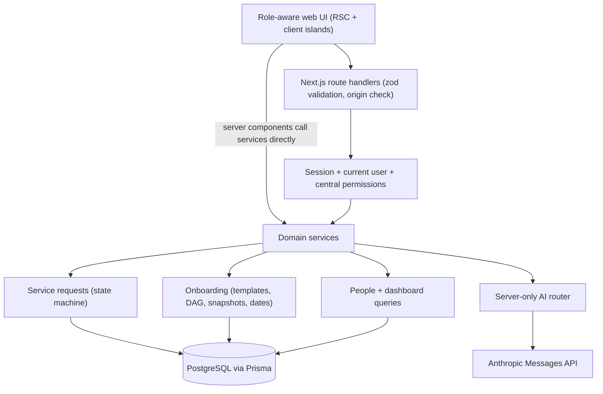
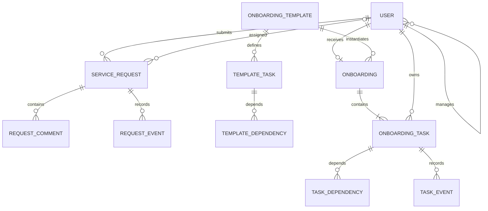

# People Operations — Architecture

Status: **implemented locally (phases 1–5); not yet deployed**. This document describes the architecture as built; changes from the Phase 0 design are recorded in the decision log at the end. Evidence for every acceptance check is in `docs/ACCEPTANCE.md`.

People Operations is a small HRIS for a single organisation (≈100 people across Bangladesh, Malaysia, Sri Lanka and Cyprus) with two modules on a shared user/authentication base:

1. **Service requests** — employees raise IT/software/HR/facilities/other requests that move through a strict lifecycle with comments and history.
2. **Onboarding** — HR builds dependency-aware checklist templates and assigns them to new hires; each task has an owner, a calendar deadline and prerequisites.

Plus a role-scoped dashboard and one AI feature: an **advisory request router** that suggests category, priority, team and (optionally) a person for a draft request.

## 1. Requirements source and assumptions

- Specification: `Claude_HRIS_Build_Pack.md` (kept outside this repository). The assessment PDF (`HRIS_Systems_Developer_Assessment.pdf`) was **not supplied** to the implementation session, so the pack is the working specification. If the PDF is later supplied, its explicit requirements take precedence and differences are recorded in the decision log.
- Business assumptions (project decisions, not employer requirements):
  - A manager's team = **direct reports only** (`User.managerId`), never department or country peers.
  - Assignment by a manager/HR constitutes approval; there is no separate approval state.
  - Every role can submit its own requests and see its own onboarding. Roles add privileges; department is **not** a role.
  - An employee assigned a request can read and work **that request** (assignee exception), even if submitted by someone else.
  - One onboarding checklist per employee (`Onboarding.employeeId` unique). A second assignment returns 409.
  - Deadlines are calendar days: Day 1 = joining date; Day 7 = joining + 6; Day 30 = joining + 29.
  - Overdue is a derived flag, not a status; a task can be BLOCKED and overdue at the same time.
  - No reopening completed tasks or closed requests (MVP limitation).
  - Template edits apply to future assignments only; assigned checklists are snapshots.
  - ERACare UI reuse is disclosed in `docs/REUSE_MANIFEST.md`; if reuse is disallowed, copied components are replaced without changing the domain design.
  - The pack's seed section states two different minimums (Section 1: five threads of 2–4 comments, 5–10 hires with 8–12 tasks; Section 7: eight threads of three comments, eight hires with ten-task template). The seed targets the stricter Section 7 figures, which satisfy both.

## 2. Components

A single deployable **Next.js (App Router, TypeScript)** application:

- Server-rendered pages and **route handlers** (`src/app/api/**`) that validate input with **zod** and call **domain services** (`src/server/**`).
- **PostgreSQL** via **Prisma**. Database access exists only in `src/server/**`.
- **iron-session** encrypted HttpOnly cookie holding `{userId, sessionVersion}` only; **bcryptjs** password hashes.
- Selected shadcn/Tailwind components adapted from ERACare (`src/components/ui/**`).
- A server-only **Anthropic adapter** (`src/server/ai/**`) for routing suggestions. The model comes from `ANTHROPIC_MODEL`; AI is advisory and never authorizes or mutates anything.



Architecture rules:

- Route handlers: parse/validate → `requireUser()` → service call → DTO. Services enforce authorization and workflow rules; pages never contain the only copy of a security rule.
- Server components call the same services as the APIs (no internal HTTP to self).
- No separate backend service, queue, Redis or microservices.
- Request descriptions/comments are plain text, rendered escaped by React (no `dangerouslySetInnerHTML`).
- Typed DTO mappers (`src/server/**/dto.ts`); full `User` rows are never serialized. Password hashes and session data never appear in responses or logs.
- Authenticated responses are dynamic and `Cache-Control: private, no-store`.
- Pagination: `page` default 1, `pageSize` default 20, max 100; stable ordering by timestamp then id.
- Errors use one envelope `{error:{code,message,fieldErrors?},requestId}`; stack traces are never returned.

### 2.1 Source organisation

```text
src/app/(auth)/login/page.tsx
src/app/(app)/layout.tsx                 # requires session, renders shell/nav by role
src/app/(app)/dashboard/page.tsx
src/app/(app)/requests/{page,new/page,[id]/page}.tsx
src/app/(app)/my-work/page.tsx
src/app/(app)/onboarding/{page,[id]/page,assign/page}.tsx
src/app/(app)/templates/{page,new/page,[id]/page}.tsx
src/app/(app)/employees/page.tsx
src/app/api/**/route.ts                  # thin handlers, see docs/API_CONTRACT.md
src/components/ui/**                     # adapted ERACare/shadcn primitives
src/components/{layout,requests,onboarding,dashboard,employees}/**
src/server/http.ts                       # handler wrapper, error envelope, origin check, pagination
src/server/errors.ts                     # AppError hierarchy -> HTTP status
src/server/auth/{session,current-user,permissions,password,throttle}.ts
src/server/requests/{service,schemas,state-machine,dto}.ts
src/server/onboarding/{service,templates,schemas,dependencies,dates,dto}.ts
src/server/people/{service,schemas,dto}.ts
src/server/dashboard/service.ts
src/server/ai/{provider,router,schema}.ts
src/server/db.ts
src/lib/{utils,format}.ts                # client-safe helpers
prisma/schema.prisma, prisma/migrations/**, prisma/seed.ts, prisma/verify-seed.ts
tests/unit/**, tests/integration/**, tests/e2e/**
```

### 2.2 Dependency set

Exact versions are pinned in `package.json` and locked in `package-lock.json` (resolved 2026-11-09): Next.js 16.4.5, React 19.3.1, Prisma CLI + client 6.19.3, zod 4.6.7, iron-session 8.0.4, bcryptjs 3.0.3, @anthropic-ai/sdk 1.6.0, Tailwind CSS 3.4.19, TypeScript 5.9.3, ESLint 10.14 with eslint-config-next 16.4.5, Playwright 1.63.0, tsx 4.23. Only packages actually used are installed (the donor's MSAL, nodemailer, xlsx, reactflow, calendar etc. are excluded). `overrides.deepmerge-ts = 8.0.0` removes a high-severity advisory inside Prisma's CLI config loader.

Prisma 7/8 were available but would require driver adapters and a config-file migration; v6 is the latest line matching the code and the docs it was written against (trade-off recorded in §9).

Tests: Node's built-in `node:test` runner (via tsx) for unit and HTTP-level integration tests; Playwright for end-to-end flows. Integration and e2e runs create a fresh uniquely named PostgreSQL database per run on the `TEST_DATABASE_URL` server, migrate and seed it, run the production build against it on port 3100, and drop only that database afterwards.

## 3. Data model

Notation: `uuid` server-generated; `text(n)` validated max length; `timestamptz` UTC instants; `date` calendar date; `?` nullable.

Enums: `Role {EMPLOYEE, MANAGER, HR_ADMIN}`, `CountryCode {BD, MY, LK, CY}`, `EmploymentStatus {ACTIVE, ON_PROBATION, ON_NOTICE}`, `RequestStatus {SUBMITTED, ASSIGNED, IN_PROGRESS, RESOLVED, CLOSED}`, `Priority {LOW, MEDIUM, HIGH, URGENT}`, `TaskStatus {NOT_STARTED, IN_PROGRESS, COMPLETED}` (BLOCKED is derived), `RequestEventKind {CREATED, ASSIGNED, REASSIGNED, STATUS_CHANGED}`.

| Table | Fields and constraints |
| --- | --- |
| Country | code CountryCode PK; name text unique; timezone text (IANA) |
| Department | id uuid PK; name text(80) unique; isActive bool default true |
| User | id uuid PK; name text(120); email text(254) unique, lowercase; passwordHash; role Role; countryCode FK; departmentId FK; managerId uuid? self-FK; joiningDate date; employmentStatus; loginEnabled bool default true; sessionVersion int default 1; createdAt/updatedAt |
| RequestCategory | id uuid PK; code text unique (IT_EQUIPMENT, SOFTWARE_ACCESS, HR_QUERY, FACILITIES, OTHER); name text(80); defaultDepartmentId FK |
| ServiceRequest | id uuid PK; number int unique (DB sequence); title text(160); description text(5000); categoryId FK; priority; status default SUBMITTED; requesterId FK; assigneeId? FK; version int default 1; createdAt/updatedAt; resolvedAt?/closedAt? |
| RequestComment | id; requestId FK; authorId FK; body text(3000); createdAt |
| RequestEvent | id; requestId FK; actorId FK; kind; fromStatus?; toStatus; previousAssigneeId?/newAssigneeId? FK User; createdAt |
| OnboardingTemplate | id; name text(120); description text(2000); isActive default true; version default 1; createdById FK; createdAt/updatedAt |
| TemplateTask | id; templateId FK; key text(50); title text(160); description text(3000); departmentId FK; dueDay int ≥1; sortOrder int ≥0; unique(templateId,key); unique(templateId,sortOrder) |
| TemplateDependency | taskId FK; prerequisiteTaskId FK; PK(taskId,prerequisiteTaskId); CHECK no self-edge; same-template enforced in service |
| Onboarding | id; employeeId FK **unique**; templateId FK; templateVersion; templateName snapshot; startDate date; timezone snapshot; assignedById FK; assignedAt; completedAt? |
| OnboardingTask | id; onboardingId FK; sourceTaskKey; title/description snapshot; departmentId FK; ownerId FK; dueDay; dueDate date; status default NOT_STARTED; sortOrder; version default 1; startedAt?/completedAt?; createdAt/updatedAt; unique(onboardingId,sourceTaskKey) |
| TaskDependency | taskId FK; prerequisiteTaskId FK; PK pair; CHECK no self-edge; same onboarding enforced in service |
| TaskEvent | id; taskId FK; actorId FK; fromStatus; toStatus; createdAt |
| LoginThrottle | keyHash text PK (SHA-256 of normalized email + IP); windowStartedAt; attemptCount; expiresAt |
| AiUsageBucket | userId FK; windowStart; count; PK(userId,windowStart) |

Indexes: User(managerId), User(countryCode,employmentStatus), User(departmentId); ServiceRequest(requesterId,createdAt), (assigneeId,status), (status,categoryId), (priority); RequestComment(requestId,createdAt); RequestEvent(requestId,createdAt); TemplateTask(templateId,sortOrder); TemplateDependency(prerequisiteTaskId); TaskDependency(prerequisiteTaskId); OnboardingTask(ownerId,status), (onboardingId,status), (dueDate,status); TaskEvent(taskId,createdAt); LoginThrottle(expiresAt).

Database CHECK constraints (added in the migration SQL): request assignee consistency (`status = 'SUBMITTED'` ⇔ `assigneeId IS NULL`), `dueDay >= 1`, `sortOrder >= 0`, no self-edges in both dependency tables, `managerId <> id`.

Referential rules: `onDelete: Restrict` everywhere people/departments/categories are referenced; no hard-delete endpoints for employees (disable login instead), requests or onboardings. Template update replaces child tasks transactionally (dependencies deleted first); assigned checklists reference `sourceTaskKey`, not template task IDs.

Service-level invariants: `managerId` is not self and refers to a login-enabled MANAGER or HR_ADMIN; no reporting cycles; assignee/owner is login-enabled; role is never client-supplied for the session; demoting a manager with direct reports is rejected (422).



## 4. Authentication and authorization

- Logout destroys the cookie **and increments `sessionVersion`**, so a copied pre-logout cookie is rejected too (sealed cookies are otherwise stateless). Trade-off: logout ends the user's sessions on all devices.
- Login: zod-validated `{email,password}`; email normalized; throttled (10 attempts / 15 min per email+IP, DB-backed atomic upsert); bcrypt compare (a dummy compare runs for unknown emails to equalize timing); generic `INVALID_CREDENTIALS`. Success regenerates the session.
- Session cookie: iron-session, HttpOnly, `Secure` when `APP_URL` is https, SameSite=Lax, path `/`, 7 days. Contains `{userId, sessionVersion}` only.
- `getCurrentUser()` loads the user on every protected request and denies missing, `loginEnabled=false`, or `sessionVersion` mismatch. Disabling an account or changing its password increments `sessionVersion`.
- Mutations require `Origin` equal to the configured `APP_URL` origin (Host header is never trusted).
- Central policy module `src/server/auth/permissions.ts`: `isHrAdmin`, `isDirectManagerOf`, `canReadRequest`, `canAssignRequest`, `canTransitionRequest`, `canReadOnboarding`, `canWorkTask`, plus `requestReadScopeWhere(actor)` / `onboardingReadScopeWhere(actor)` Prisma filters so list queries and detail checks share one definition.
- Out-of-scope records → 404; visible record but disallowed action → 403.

Full matrix: `docs/PERMISSIONS.md`.

## 5. Request state machine

| From | Action | To | Actor / preconditions |
| --- | --- | --- | --- |
| — | Submit | SUBMITTED | Any user; requester = self |
| SUBMITTED | Assign | ASSIGNED | HR, or requester's direct manager (not for own request); eligible login-enabled assignee |
| ASSIGNED | Reassign | ASSIGNED | Same actors; different eligible assignee; only before work starts |
| ASSIGNED | Start | IN_PROGRESS | Current assignee only |
| IN_PROGRESS | Resolve | RESOLVED | Current assignee only |
| RESOLVED | Close | CLOSED | Requester, requester's direct manager, or HR |

Pure transition table in `src/server/requests/state-machine.ts`. Every mutation carries `expectedVersion`; the service runs `updateMany({where:{id, version, status}})` inside a transaction, increments `version`, and appends the `RequestEvent` in the same transaction. Zero rows → 409 `STALE_VERSION`. No events without the mutation.

## 6. Onboarding rules and dates

- Templates: 1–30 tasks; unique keys and sort orders; prerequisites must reference keys in the same template; no self-edges; cycles detected with Kahn topological sort (`dependencies.ts`), returning the keys involved. Update requires `expectedVersion` and replaces tasks atomically, incrementing version.
- Assignment: HR picks employee + active template; `assignment-options` returns computed due dates and eligible owners per task (department members; for the `Manager` department, only the hire's direct manager). HR supplies one owner per task. One transaction: verify template version, create `Onboarding`, snapshot tasks, map keys → new IDs for `TaskDependency`. Unique `employeeId` → 409. Missing/ineligible owner → 422 with no partial rows.
- Timezones: BD Asia/Dhaka, MY Asia/Kuala_Lumpur, LK Asia/Colombo, CY Asia/Nicosia; snapshotted on the onboarding.
- `dueDate = startDate + (dueDay − 1)` days using UTC date-only arithmetic (no local-time milliseconds; DST cannot shift it).
- `isOverdue = status ≠ COMPLETED && todayIn(timezone) > dueDate`, where `todayIn` uses `Intl.DateTimeFormat` with the IANA zone. One function (`dates.ts`) is used by dashboard, lists, detail and My Work.
- `effectiveStatus = BLOCKED` if stored `NOT_STARTED` and any prerequisite is not `COMPLETED`; otherwise stored status. Clients cannot set BLOCKED.
- Start: owner only, stored NOT_STARTED, all prerequisites COMPLETED. Complete: owner only, IN_PROGRESS. Each transition is version-checked and writes a `TaskEvent`.
- Concurrency for completion: the transaction first takes `SELECT … FOR UPDATE` on the parent `Onboarding` row, which serializes task transitions within one checklist; after completing it counts incomplete tasks and sets `completedAt` when zero. Two concurrent final completions therefore cannot both observe "one remaining".
- Counts: pending = total − completed; blocked and overdue are overlapping flags; percent = round(completed/total·100).

## 7. Dashboard

HR dashboard (`/api/dashboard`) computed from the database at one `asOf` instant: headcount by country (all employees regardless of status), open requests (SUBMITTED/ASSIGNED/IN_PROGRESS) by status and category, active hires (onboardings with incomplete tasks), overdue tasks (shared date function), and the cross-module insight: employees who joined within the preceding 60 days, have an onboarding, and have open IT_EQUIPMENT requests. A bar chart (plain SVG/CSS, with a text table) shows requests by status and category. Non-HR users get `/api/dashboard/mine` (personal and, for managers, direct-report team summaries).

## 8. AI request router

Flow: draft title/description → `POST /api/ai/route-request` → authenticate, origin check, validate lengths, DB-backed rate limit (10/min/user, counted before any provider call) → load categories, departments and a capped candidate list (≤60 login-enabled users in the support departments: opaque id, name, department, country only — no email or HR fields) → Anthropic Messages API with **structured outputs** (`output_config.format` JSON schema), model from `ANTHROPIC_MODEL`, 7 s per attempt and one SDK retry (≈15 s budget) → strict zod validation against the live IDs → `RouterDTO {categoryId, priority, suggestedDepartmentId, suggestedAssigneeId|null, suggestedAssigneeName|null, explanation(≤300), needsReview:true}`. Unknown category/department/priority → 503 `AI_INVALID_OUTPUT`; a suggested person not in the suggested department or not in the candidate set is replaced with `null`. The request text is fenced as untrusted data in the user turn; the system prompt is the pack's template. Nothing is written to the request. Logs contain request id, latency and outcome only. Missing key → 503 `AI_UNAVAILABLE`; the request form keeps the draft and manual submission works. No deterministic fallback is labelled as AI.

## 8a. Endpoint inventory

Full input/output DTOs and error codes: `docs/API_CONTRACT.md`. All routes return `{data}` / `{data, meta}` or `{error:{code,message,fieldErrors?}, requestId}`; mutations require `Origin` = `APP_URL`.

| Area | Endpoints | Authorization (enforced in services) |
| --- | --- | --- |
| Auth | `POST /auth/login`, `POST /auth/logout`, `GET /auth/me` | public (throttled) / session |
| Lookups | `GET /countries`, `/departments`, `/request-categories` | any session |
| Employees | `GET,POST /employees`, `GET,PATCH /employees/:id`, `GET /employees/manager-options` | list: HR all, manager self+reports, employee 403; writes HR |
| Requests | `GET,POST /requests`, `GET /requests/:id`, `GET,POST /requests/:id/comments`, `GET /requests/:id/events`, `GET /requests/:id/assignee-options`, `POST /requests/:id/assign`, `POST /requests/:id/transition` | read scope = own/assigned/direct reports/HR (else 404); assign = HR or requester's manager; start/resolve = assignee; close = requester/manager/HR |
| Templates | `GET,POST /onboarding-templates`, `GET,PUT /onboarding-templates/:id` | HR |
| Onboarding | `GET,POST /onboarding`, `GET /onboarding/:id`, `GET /onboarding/assignment-options`, `GET /onboarding/unassigned-employees` | read own/reports/all; assign HR |
| Tasks | `POST /onboarding-tasks/:id/transition`, `GET /onboarding-tasks/:id/events` | transition owner only; events owner or checklist scope |
| Work & dashboard | `GET /my-work`, `GET /dashboard` (HR), `GET /dashboard/mine` | current user's assignments; HR org view |
| AI | `POST /ai/route-request` | any session; 10/min/user; never writes |
| Health | `GET /health` | public, no configuration details |

## 9. Trade-offs

1. **Single Next.js deployment vs separate frontend/backend.** Fewer moving parts for a four-day build and a 100-person organisation; the `src/server` domain-service boundary keeps extraction possible later. Cost: API and UI scale together.
2. **Relational PostgreSQL vs document store.** Reporting lines, request history and task DAGs need relations, constraints and transactions. Larger scale would be tuned with query plans and workload evidence.
3. **Selective UI reuse vs ERACare fork.** Saves presentation work without importing MSP contracts, legacy permissions, migrations or unrelated modules. Cost: provenance must be disclosed and maintained.
4. **Snapshot onboarding vs live templates.** Existing hires keep stable tasks/deadlines when templates change. Cost: fixing a template error for already-assigned hires needs an explicit (future) migration feature.
5. **Advisory AI vs autonomous assignment.** Suggestions are reviewed and cannot bypass manager permissions. Cost: an extra click; routing accuracy is not yet measured.
6. **Derived BLOCKED/overdue vs stored statuses.** No scheduler and no stale flags. Cost: computed on read (cheap at this size).
7. **Row lock on Onboarding vs SERIALIZABLE + retry.** A per-checklist `FOR UPDATE` is simple to reason about and test; contention is only within one hire's checklist.
8. **Prisma 6 vs 7/8.** Staying on the v6 client avoids a driver-adapter/config migration during a four-day build; cost: an upgrade is deferred work.
9. **Stateless sealed cookie + `sessionVersion` vs server-side session table.** No session store to run; revocation is per-user (logout/disable bumps the version), not per-device.

## 10. Limitations (MVP)

No reopening, cancellation or deletion of requests/tasks; no attachments, email, notifications, password reset or public signup; templates cannot be migrated onto existing checklists; AI routing accuracy is not evaluated beyond the scenario list in `docs/ACCEPTANCE.md`. My Work filters derived flags (blocked/overdue) in memory after loading an owner's tasks — fine for hundreds of tasks per owner, not for very large volumes. Request list search uses `ILIKE` without trigram indexes. Logout signs a user out on all devices. Overdue counts change over time by design (they are computed against "today" in each hire's timezone).

## 11. Decision log

| Date | Decision |
| --- | --- |
| 2026-11-09 | Assessment PDF not supplied; build pack used as specification. |
| 2026-11-09 | Seed targets Section 7 figures (stricter than Section 1 minimums). |
| 2026-11-09 | Onboarding completion concurrency: `SELECT … FOR UPDATE` on Onboarding row. |
| 2026-11-09 | npm registry initially blocked by session egress policy; unblocked by the candidate the same day. Versions resolved as in §2.2. |
| 2026-11-09 | Tests use `node:test` instead of Vitest (fewer dependencies; ran before install). |
| 2026-11-09 | AI adapter uses structured outputs instead of forced tool use (SDK 1.x; sampling params removed). |
| 2026-11-09 | Logout increments `sessionVersion` (fix for BUG-1, copied cookie still valid after logout). |
| 2026-11-09 | Prisma refuses `migrate reset` from an AI agent without user consent; test runner uses a fresh per-run database instead of resetting. |
| 2026-11-09 | Added narrow lookups `/employees/manager-options`, `/onboarding/unassigned-employees`; RouterDTO gains `suggestedAssigneeName`. |
| 2026-11-09 | Onboarding owner eligibility excludes the hire themself; request assignee cannot be the requester. |
